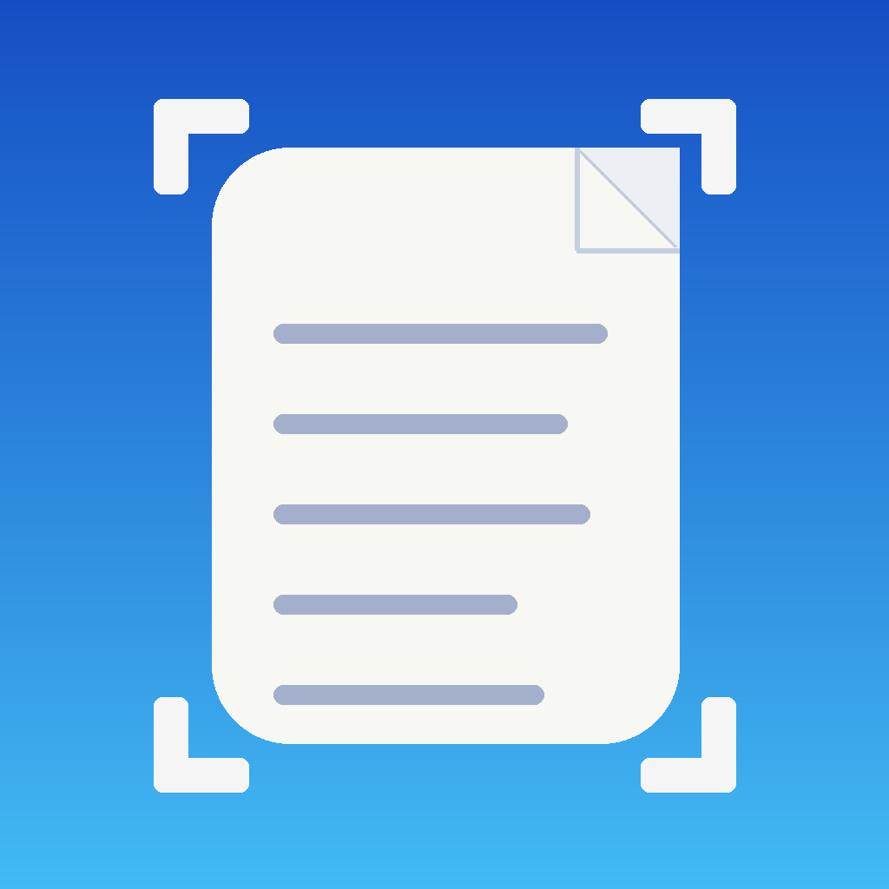

<p align="center">
  
</p>

<h1 align="center">DocScanner: PDF Scan</h1>

<p align="center">
  Scan paper into searchable PDFs, organize documents, and protect sensitive files on your iPhone or iPad.
</p>

<p align="center">
  <a href="https://youssef.tn/DocScanner/">Website</a>
  · <a href="https://apps.apple.com/app/id6760237829">App Store</a>
  · <a href="legal/privacy-policy.md">Privacy</a>
  · <a href="SUPPORT.md">Support</a>
  · <a href="CONTRIBUTING.md">Contributing</a>
</p>

<p align="center">
  
  
  
</p>

DocScanner is a native SwiftUI app. Document storage and OCR run on-device. Secure folders encrypt titles, PDFs, and previews and use Face ID, Touch ID, or the device passcode to unlock. You can also export a password-protected copy of a PDF.

## Build from source

Use a Mac with Xcode 26.2 or later. The app supports iOS and iPadOS 16 or later. Camera capture requires a physical iPhone or iPad.

```bash
git clone https://github.com/youssefsz/document-scanner-native-ios-app.git
cd document-scanner-native-ios-app
open document-scaner.xcodeproj
```

In Xcode, select the `document-scaner` scheme and an installed iOS simulator. Press <kbd>⌘R</kbd> to run. See [Contributing](CONTRIBUTING.md) for tests, local configuration, and the StoreKit scheme.

## Documentation

- [Security design](docs/SECURITY_DESIGN.md) and [vulnerability reporting](SECURITY.md)
- [Secure-folder migration and release checks](docs/VAULT_TRANSFER.md)
- [Product website development](landing-page/README.md)

## License

The source code is available under the [MIT License](LICENSE). The app icon, screenshots, and artwork are covered by a separate [visual asset policy](BRAND_ASSETS.md). The App Store build remains subject to Apple's terms and the app's [Terms of Use](legal/terms-of-use.md).

Copyright © 2026 [Youssef Dhibi](https://dhibi.tn).
